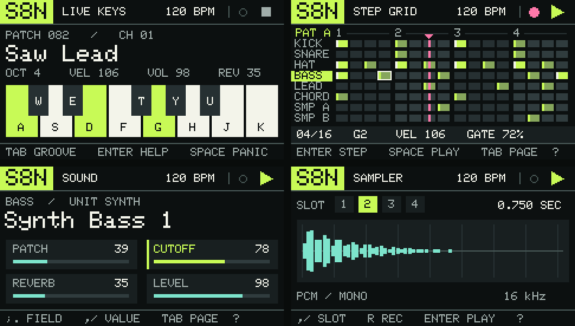

# S8N Synth v0.2

S8N turns the original M5Stack Cardputer (K132) and one Unit Synth or Unit MIDI into a pocket groovebox. It boots into the original Saw Lead keyboard. Press **Tab**, then **Space**, to start the first of four factory grooves at 110 BPM. Press **1–4** to change the groove while it plays.

[Download the v0.2 firmware](firmware/S8N-Synth-v0.2-Cardputer-merged.bin?raw=1) · [Flashing and first groove](docs/S8N-Synth-Quickstart.txt)



## Hookup

Power off the Cardputer, plug either unit into its Grove socket with the stock cable, and insert a FAT32 microSD for samples, projects and takes. Power up. The Unit Synth plays through its speaker. On Unit MIDI, connect headphones or powered speakers to **AUDIO**. Use **FROM CORE / Separate** to send the groove to external MIDI OUT, or **BYPASS** to play the selected groove lane from MIDI IN. The engine uses its own clock.

| Sound | Where it goes |
|---|---|
| Synth, chords and GM drums | Cardputer TX on GPIO2 sends MIDI at 31,250 baud. The attached unit produces the sound. |
| Sample pads and recorded-take playback | Cardputer speaker |
| Recorded audio | Cardputer microphone captures the room. A sounding Unit Synth or a speaker connected to Unit MIDI can be captured acoustically. |
| External notes | Unit MIDI in BYPASS sends incoming notes on GPIO1. The groovebox maps them to the selected lane. |

The onboard mic and speaker share GPIO43. Local sample playback pauses during microphone capture. The external synth can continue throughout a take. Unit MIDI's AUDIO jack carries its synth output alone. Groovebox MIDI input accepts note-on/off and release controls. Project files store the note data digitally.

## Make a loop

1. From **Live Keys**, press **Tab** for **Step Grid**, then **Space**. The eight lanes are kick, snare, hat, bass, lead, chord, Sample A and Sample B.
2. Use **;** and **.** to select a lane, **,** and **/** to move along its 16 steps, and **Enter** to add or remove a hit. **M** mutes the selected lane. The white outline marks your edit position and the moving pink line shows playback.
3. On a melodic lane, play **A W S E D F T G Y H U J K**. **R** arms overdub. With the transport running, notes land on the nearest swung sixteenth. Each lane stores one pitch per step. Chord plays a major triad from that root.
4. **Tab** opens **Sound** for the selected lane. Pick a field with **;** or **.**, then adjust with **,** or **/**. Hold **Fn** for larger changes. Melodic lanes have 128 GM programs, volume, filter cutoff and reverb. Drum lanes edit the current step's MIDI drum note and the lane level. Sample lanes choose a pad slot and level.
5. Tab through **Sampler** to **Project**, select a slot with **,** or **/**, then press **S**. **L** recalls that slot, stops the transport and selects pattern A. Save before recalling another project. The next boot starts with the factory groove, so recall a saved project when you want it back.

**Tab** cycles the four groovebox pages while the music plays. The **backtick** key stops the groove and returns to Live Keys. **Shift + /** opens the current page's key guide. **G0** is the physical panic button.

### Grid controls

| Keys | Action |
|---|---|
| Space / R | Start or stop / arm or disarm note overdub |
| 1, 2, 3, 4 | Select pattern A, B, C or D at the current transport position |
| - / = | Tempo, 40–240 BPM |
| Z / X | Swing, 50–75% |
| [ / ] | Lower / raise the current step's pitch |
| 5 / 6 | Edit step velocity in increments of 8. Editing a rest assigns a hit. |
| 7 / 8 | Edit step gate in increments of 5%. Sample slots always play as one-shots. |
| 9 / 0 | Lower / raise the melodic keyboard octave |
| Fn + a piano key while stopped | Audition and write that pitch to the current step |
| M / G0 | Mute selected lane / stop transport and release voices |

### Original Live Keys controls

| Keys | Action |
|---|---|
| A W S E D F T G Y H U J K | C through the next C, or 13 percussion hits |
| 1 / 2 | Previous / next GM patch |
| 3 / 4 and 5 / 6 | Volume down / up and velocity down / up |
| 7 / 8 | Octave down / up |
| 9 / 0 | Toggle keys and drums / cycle reverb |
| Space or G0 | Panic across all 16 MIDI channels |
| Enter / Tab | Open or close the guide / enter the groovebox |

## Sample a hit

On **Sampler**, pick one of four slots with **,** or **/**. Press **R**, make a sound, then press **R** again to finish early. Capture stops automatically at **0.75 seconds**. **Enter** plays the result. Each slot starts with a generated kick, snare, hat or tom, so the sampler works before your first recording.

Successful captures replace the selected slot in RAM and auto-save when microSD is available. The pads are shared by all eight project slots. To use a captured hit in a groove, select Sample A or B on the Grid, assign its slot in Sound, then toggle steps.

To import your own hits, place **16 kHz, mono, signed 16-bit PCM WAV** files of up to **12,000 frames** at `/S8N/S01.WAV` through `/S8N/S04.WAV`. The firmware loads them at boot. On Sampler, **L** reloads the selected file and **S** saves the current pad. Without microSD, the four pads and groove edit in RAM.

## Record a longer take

On **Project**, press **R** to start recording the mic to microSD. You can return to the Grid and perform with the hardware synth. Come back to Project and press **R** to finish. **P** plays the latest finished take through the Cardputer. Press **P** again to stop playback.

Takes are numbered `/S8N/TAKES/T0001.WAV`, `T0002.WAV` and so on. Each is mono 16-bit PCM at 16 kHz, about **1.92 MB per minute**. A take closes at one hour, or earlier if the microphone queue overruns. Finish the take before powering off or removing the card. An interrupted write may leave a `.TMP` file. Earlier numbered WAVs are preserved.

## Build and install

The project retains the v0.1 PlatformIO target. The exact M5 library versions are pinned in `platformio.ini`. From this folder, run:

```sh
python -m pip install platformio==6.2.0
python -m platformio run -e cardputer
```

To install over USB once you're ready to replace the current firmware, use `python -m platformio run -e cardputer --target upload`. Add `--upload-port COM5` (or your actual port) if needed. For a board that requires manual download mode, use M5Stack's G0-at-power-on procedure. PlatformIO writes the bootloader, partition layout and application together. The build's `.pio/build/cardputer/firmware.bin` is the application partition at **0x10000**.

The separate release file **S8N-Synth-v0.2-Cardputer-merged.bin** contains the bootloader, partitions and application. Use a full-flash tool at address **0x0**. The source build and this merged image target the original 8 MB Cardputer.

## Verification

The host suites under `tests/` exercise Live Keys, the sequencer, swing, MIDI byte parsing, time rollover, overlapping notes, sample capture and import, full-length take playback, and project recall after interrupted writes. The commands are in the build workflow. The audio suites simulate the driver and SD card. Follow the hardware checks in [BENCH_TEST.md](docs/BENCH_TEST.md) for listening, switch routing and SD timing.

Built on the original [S8N Synth project](https://github.com/H3llawts/Cardputer-S8N-Synth), revision `54267a9`. Hardware references from M5Stack cover the [Cardputer](https://docs.m5stack.com/en/core/Cardputer), [Unit Synth](https://docs.m5stack.com/en/unit/Unit_Synth), and [Unit MIDI](https://docs.m5stack.com/en/unit/Unit_MIDI).
